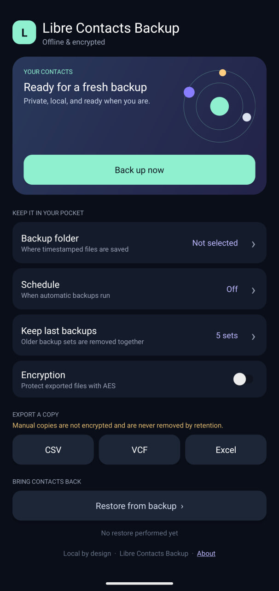

# Libre Contacts Backup

A free, open-source, native Android app that backs up your contacts — local-first, private, and fully yours.

- **Libre & open source** — GPL-3.0, no proprietary bits, buildable from source, [available on F-Droid](https://f-droid.org/en/packages/com.ashkanrafiee.librecontactsbackup/).
- **Private by design** — no account, no cloud, no analytics, no network permission at all. Contacts are read only for a backup, export, or restore that you start or schedule. See the [privacy policy](PRIVACY.md) for the full boundary.
- **Local by design** — backups are written to a folder you choose on your own device (or SD card); the app never uploads them automatically. You control any export, report sharing, or cloud-backed storage you choose.
- **Scheduled backups** — daily, weekly, or monthly at a time you choose, running automatically in the background, entirely on-device (on Android 12 and above, allow alarms & reminders when asked; turn off battery optimization for the app to reduce missed runs).
- **Retention by age** — keep the newest backups per day, week, and month with counts you choose (e.g. 7 daily + 4 weekly + 3 monthly), so backups of increasing age stay available while old ones thin out; or keep it simple and just keep the last N sets.
- **As close to lossless as the Contacts Provider allows** — preserves the full Contact → RawContact → Data hierarchy (every readable field, every account, every custom type), not a lossy flattened copy.
- **SIM card phonebook included on a best-effort basis** — when the device exposes its SIM phonebook, backups capture those contacts; if it cannot be read, the backup reports that it contains device contacts only. On restore, you choose whether SIM contacts are written back to the SIM card, into the device address book, or both.
- **Optional encryption** — AES-256-GCM with a key derived from your password (PBKDF2, 600,000 iterations); the password itself is stored on-device behind an Android Keystore key so scheduled backups can run unattended.
- **Personalized display** — choose the app language and system, light, or dark theme from the Display menu in the footer.
- **Help when needed** — create a problem report from About and choose whether to include technical diagnostics before sharing it with an email or sharing app.

## Download

Libre Contacts Backup can be installed from any of these sources:

- **GitHub** — the fastest way to get the latest updates is installing the signed APK directly from the [GitHub Releases](https://github.com/AshkanRafiee/Libre-Contacts-Backup/releases) page. Pair it with [Obtainium](https://obtainium.imranr.dev/) to receive and install updates automatically.
- **F-Droid** — the preferred store edition for users who like app stores; get it from the [F-Droid listing](https://f-droid.org/en/packages/com.ashkanrafiee.librecontactsbackup/).
- **Myket and Cafe Bazaar** — alternative store editions, handy for users less familiar with the options above:
  - [Cafe Bazaar](https://cafebazaar.ir/app/com.ashkanrafiee.librecontactsbackup)
  - [Myket](https://myket.ir/app/com.ashkanrafiee.librecontactsbackup)

## Backup format

Each backup is a single timestamped `.lcb` archive containing:

| File | Purpose |
|------|---------|
| `android-contacts.json` | Canonical lossless snapshot — what restore reads from |
| `contacts.vcf` | Standard vCard 3.0 for other apps, with your groups carried as vCard categories |
| `contacts.json` / `contacts.csv` | Human-readable exports |
| `manifest.json` | Checksums and format version |

Contact photos are saved in full quality, exactly as stored on your device (up to 8 MB per photo; a larger photo falls back to its standard thumbnail).

On restore, contacts that originally belonged together (e.g. synced from Google *and* stored locally) are recreated as separate raw contacts, each keeping its own original source, and linked back together as one contact — without ever merging two different people who just happen to share a name.

Libre Contacts Backup preserves contact information, including less-common and provider-specific data that may be missed by ordinary vCard backups. During restore, you choose which available categories to include — contact information, photos, groups, additional/provider-specific data, and account information can each be restored or skipped independently. A few things to know:

- Contact IDs and RawContact IDs may change on restore; the app does not try to recreate Android's internal provider bookkeeping.
- Provider/account metadata may not be restorable on every device, and preserving it doesn't guarantee the original app (e.g. a messaging app) will recognize the contact as its own.
- Anything a selected category can't restore is reported, not silently dropped.
- Anything you don't select stays fully intact inside the `.lcb` — the archive is never modified by what you restore, and it can be restored again later with a different selection.

## Build

```bash
./gradlew assembleDebug     # unsigned debug build
./gradlew assembleRelease   # unsigned release build
```

To produce a signed release, add your own keystore details in a `signing.properties` file (see [`docs/RELEASING.md`](docs/RELEASING.md)). It's gitignored and never belongs in the repo.

## Test

Instrumented tests modify contacts and groups, so run them only against a disposable emulator. Set its serial explicitly and run via direct `adb` instrumentation:

```bash
./gradlew assembleDebug assembleDebugAndroidTest
DEVICE_SERIAL=emulator-5554
adb -s "$DEVICE_SERIAL" install -r -t -g app/build/outputs/apk/debug/app-debug.apk
adb -s "$DEVICE_SERIAL" install -r -t -g app/build/outputs/apk/androidTest/debug/app-debug-androidTest.apk
adb -s "$DEVICE_SERIAL" shell am instrument -w \
  com.ashkanrafiee.librecontactsbackup.test/androidx.test.runner.AndroidJUnitRunner
```

A green run ends with `OK (N tests)`. Run a single test class by adding `-e class <name>`.

## Donate

Libre Contacts Backup is free, open-source software, and always will be. If you find it useful, you can support its development with a donation in GRAM (prev. TON):

```
UQB4goexr3cp0QIdd2_fAJPW9REwZvrRQm-mltr1dMQtV9ig
```

You can also scan the QR code or open it in your wallet from the [donation page](https://librecontactsbackup.ashkanrafiee.com/#donate).

Thank you for your support.

## License

GPL-3.0. Source: https://github.com/AshkanRafiee/Libre-Contacts-Backup

## Screenshot


