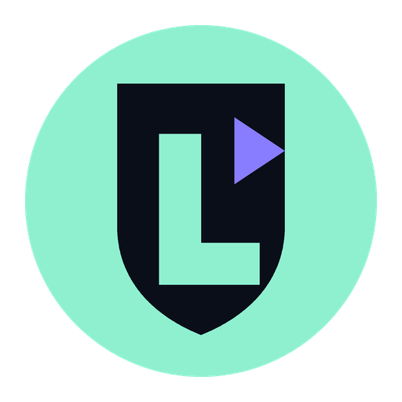
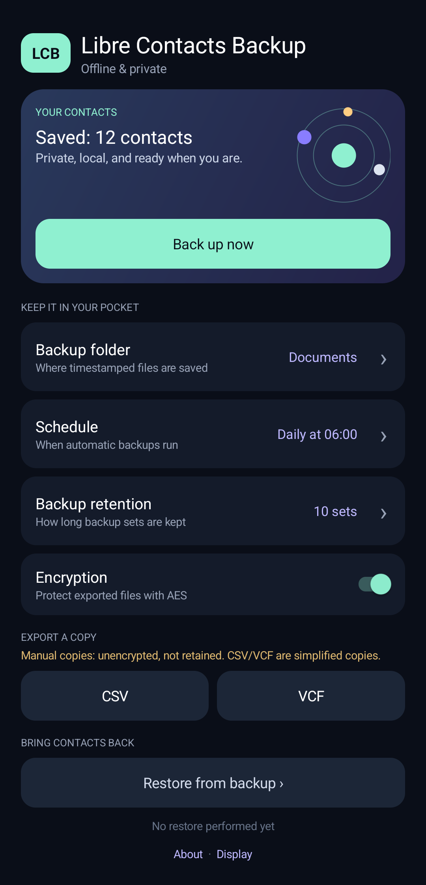
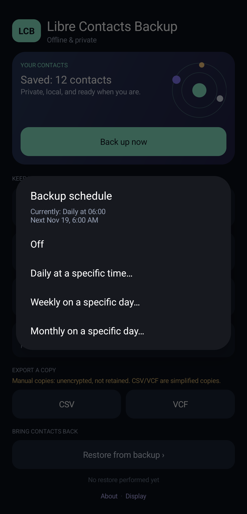
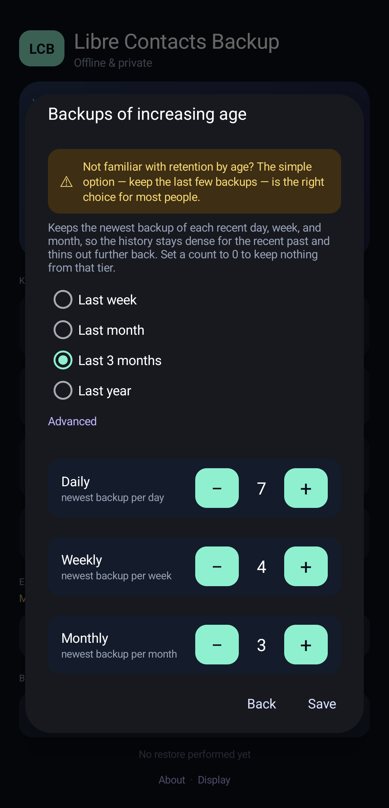

  

<h1 align="center">Libre Contacts Backup</h1>

  <strong>Your contacts. Your backups. No internet access.</strong>
   
  No account · No ads · No analytics or tracking

  <a href="https://github.com/AshkanRafiee/Libre-Contacts-Backup/releases">Download APK</a> ·
  <a href="https://f-droid.org/en/packages/com.ashkanrafiee.librecontactsbackup/">F-Droid</a> ·
  <a href="https://cafebazaar.ir/app/com.ashkanrafiee.librecontactsbackup">Cafe Bazaar</a> ·
  <a href="https://myket.ir/app/com.ashkanrafiee.librecontactsbackup">Myket</a>

Back up your Android contacts now or on a schedule. Choose where the files go, how long to keep them, and whether to lock them with a password.

## Private by design

Libre Contacts Backup has **no Android internet permission** and no cloud service. Back up and restore with a local folder, even in airplane mode. If you choose a cloud-backed folder, its provider may sync the files; Libre Contacts Backup itself does not upload them.

**Encryption is optional.** Turn it on to protect new backups with AES‑256‑GCM. Keep the original password somewhere safe: you’ll need it to restore the archive. Standalone CSV and vCard exports are **not encrypted**.

## Set your schedule. Keep the history you need.

| Feature | What you control |
| --- | --- |
| **Schedule** | Pick a time for automatic daily, weekly, or monthly backups. You can still back up manually whenever you want. |
| **Automatic retention** | Keep the newest sets, keep everything, or save the newest available backup for each day, week, and month within windows you choose (for example, the last 7 days, 4 weeks, and 3 months). The app trims older sets after a successful backup and leaves manual exports alone. |
| **Selective restore** | Keep more than a standard vCard, including photos, groups, and account information where supported. Choose what to restore without changing the original archive. SIM support depends on your device. |

## A look inside

  
  
  

## Before you start

Requires **Android 8.0+** and Contacts permission for backup and restore. For automatic backups, allow **Alarms & reminders** if prompted; Android’s battery restrictions can still interfere. If you’re preparing to replace or reset your phone, keep a copy of the backup somewhere other than that phone.

[User guide](docs/USER-GUIDE.md) · [Privacy policy](PRIVACY.md) · [GPL‑3.0 license](LICENSE) · [Report an issue](https://github.com/AshkanRafiee/Libre-Contacts-Backup/issues) · [Donate](https://librecontactsbackup.ashkanrafiee.com/#donate)
